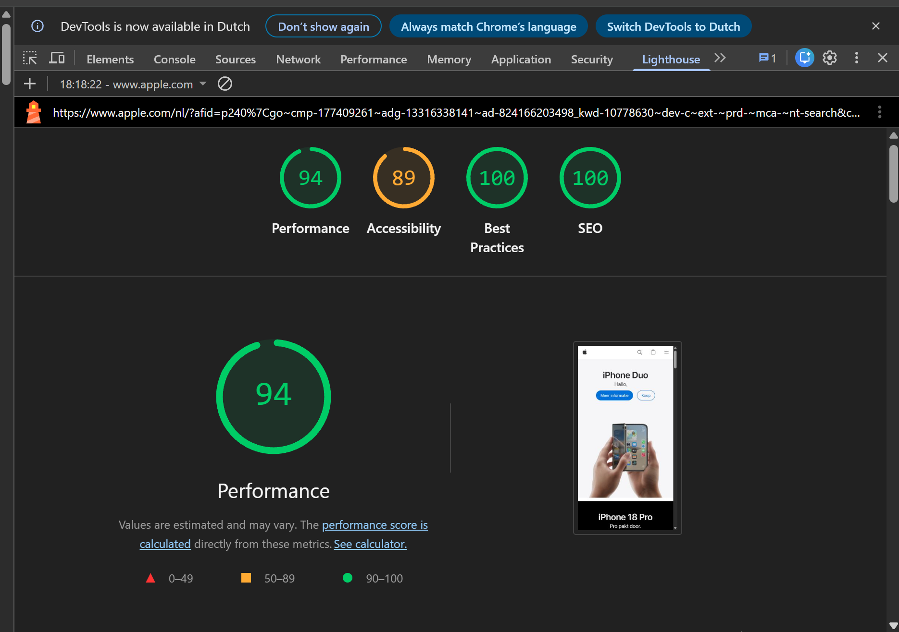
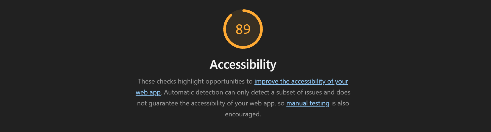
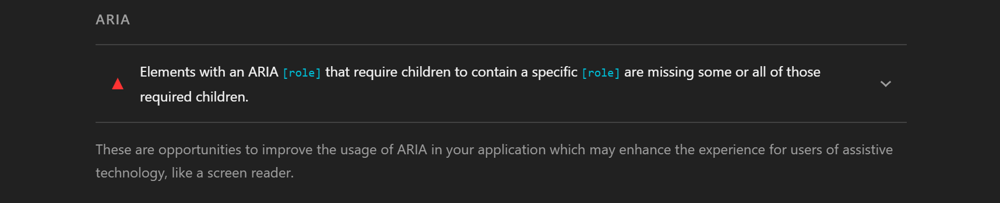
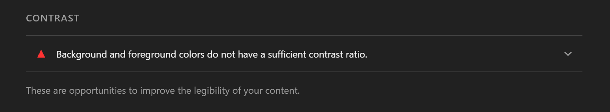
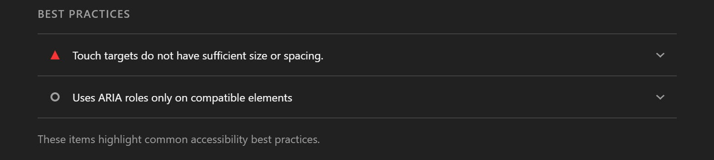
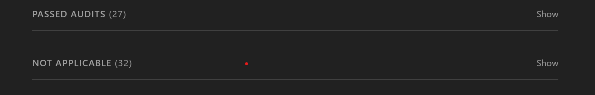

# WCAG Audit 

Doe een WCAG audit op een bestaande website uit je eigen omgeving en rapporteer daarover.

De instructies van deze opdracht staan in [WIKI](https://github.com/fdnd-task/wcag-audit/wiki).

## Apple Lighthouse Accessibility test

Voor deze opdracht heb ik een bestaande site, namelijk https://www.apple.com/nl/store getest volgends de WCAG richtlijnen. Hiervoor heb ik een Lighthouse Accessibility test gedaan. 

Om de site volgens de WCAG richtlijnen te testen heb ik een Lighthouse Accessibility test uitgevoerd via de Chrome DevTools.

Uit de test kwamen de volgende resultaten:

Performance: 94
Accessibility: 89
Best Practices: 100
SEO: 100

De website behaalde een Accessibility-score van 89. Dit betekent dat Lighthouse een aantal aandachtspunten heeft gevonden op het gebied van toegankelijkheid. De andere onderdelen scoorden 94 of hoger.

Verbeterpunten: 

- ARIA: Sommige elementen met een ARIA-rol missen verplichte onderliggende elementen.

- Contrast: Sommige teksten hebben onvoldoende contrast met de achtergrond, waardoor ze minder goed leesbaar zijn.

- Touch targets: Sommige knoppen of klikbare onderdelen zijn niet groot genoeg of staan te dicht bij elkaar.

- ARIA best practices: Sommige ARIA-rollen worden gebruikt op elementen waarvoor ze niet geschikt zijn.

- Daarnaast zijn er 27 controles goedgekeurd, 32 niet van toepassing en zijn er 10 extra punten die handmatig gecontroleerd moeten worden.

## Licentie

This project is licensed under the terms of the [MIT license](./LICENSE).
